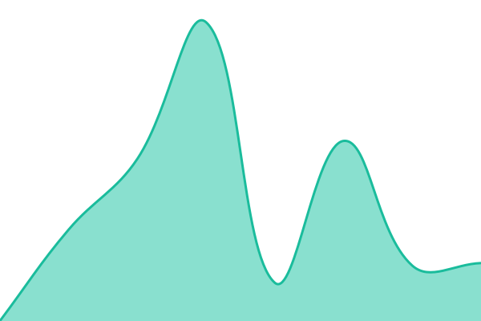
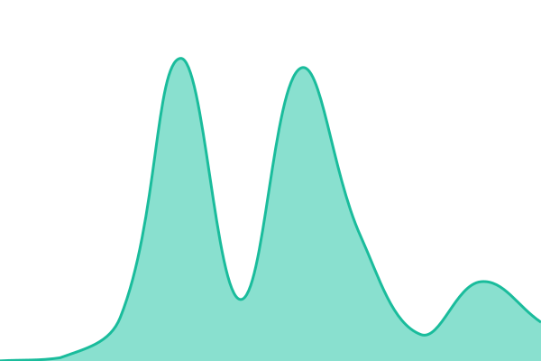

# [📈 Live Status](https://mgsrex.github.io/status): <!--live status--> **🟧 Partial outage**

This repository contains the open-source uptime monitor and status page for [Anthony Mitchell](https://mgsrex.github.io/status), powered by [Upptime](https://github.com/upptime/upptime).

With [Upptime](https://upptime.js.org), you can get your own unlimited and free uptime monitor and status page, powered entirely by a GitHub repository. We use [Issues](https://github.com/mgsrex/status/issues) as incident reports, [Actions](https://github.com/mgsrex/status/actions) as uptime monitors, and [Pages](https://mgsrex.github.io/status) for the status page.

<!--start: status pages-->
<!-- This summary is generated by Upptime (https://github.com/upptime/upptime) -->
<!-- Do not edit this manually, your changes will be overwritten -->
<!-- prettier-ignore -->
| URL | Status | History | Response Time | Uptime |
| --- | ------ | ------- | ------------- | ------ |
|  [Plex](https://plex.tyrantrepublic.io/identity) | 🟥 Down | [plex.yml](https://github.com/mgsrex/status/commits/HEAD/history/plex.yml) | 

 215ms
     
 | 

<a href="https://mgsrex.github.io/status/history/plex">0.00%</a>
    

|  [Seerr](https://requests.tyrantrepublic.io) | 🟩 Up | [seerr.yml](https://github.com/mgsrex/status/commits/HEAD/history/seerr.yml) | 

 696ms
     
 | 

<a href="https://mgsrex.github.io/status/history/seerr">97.08%</a>
    

|  [Sonarr](https://sonarr.tyrantrepublic.io) | 🟩 Up | [sonarr.yml](https://github.com/mgsrex/status/commits/HEAD/history/sonarr.yml) | 

 2293ms
     
 | 

<a href="https://mgsrex.github.io/status/history/sonarr">97.08%</a>
    

|  [Radarr](https://radarr.tyrantrepublic.io) | 🟩 Up | [radarr.yml](https://github.com/mgsrex/status/commits/HEAD/history/radarr.yml) | 

 940ms
     
 | 

<a href="https://mgsrex.github.io/status/history/radarr">97.08%</a>
    

|  [Bazarr](https://bazarr.tyrantrepublic.io) | 🟩 Up | [bazarr.yml](https://github.com/mgsrex/status/commits/HEAD/history/bazarr.yml) | 

 610ms
     
 | 

<a href="https://mgsrex.github.io/status/history/bazarr">97.09%</a>
    

|  [Prowlarr](https://prowlarr.tyrantrepublic.io) | 🟩 Up | [prowlarr.yml](https://github.com/mgsrex/status/commits/HEAD/history/prowlarr.yml) | 

 469ms
     
 | 

<a href="https://mgsrex.github.io/status/history/prowlarr">70.80%</a>
    

|  [qBittorrent](https://qbittorrent.tyrantrepublic.io) | 🟩 Up | [q-bittorrent.yml](https://github.com/mgsrex/status/commits/HEAD/history/q-bittorrent.yml) | 

 338ms
     
 | 

<a href="https://mgsrex.github.io/status/history/q-bittorrent">70.80%</a>
    

<!--end: status pages-->

[**Visit our status website →**](https://mgsrex.github.io/status)

## 📄 License

- Powered by: [Upptime](https://github.com/upptime/upptime)
- Code: [MIT](./LICENSE) © [Anand Chowdhary](https://anandchowdhary.com)
- Data in the `./history` directory: [Open Database License](https://opendatacommons.org/licenses/odbl/1-0/)
